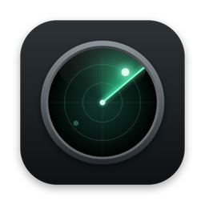
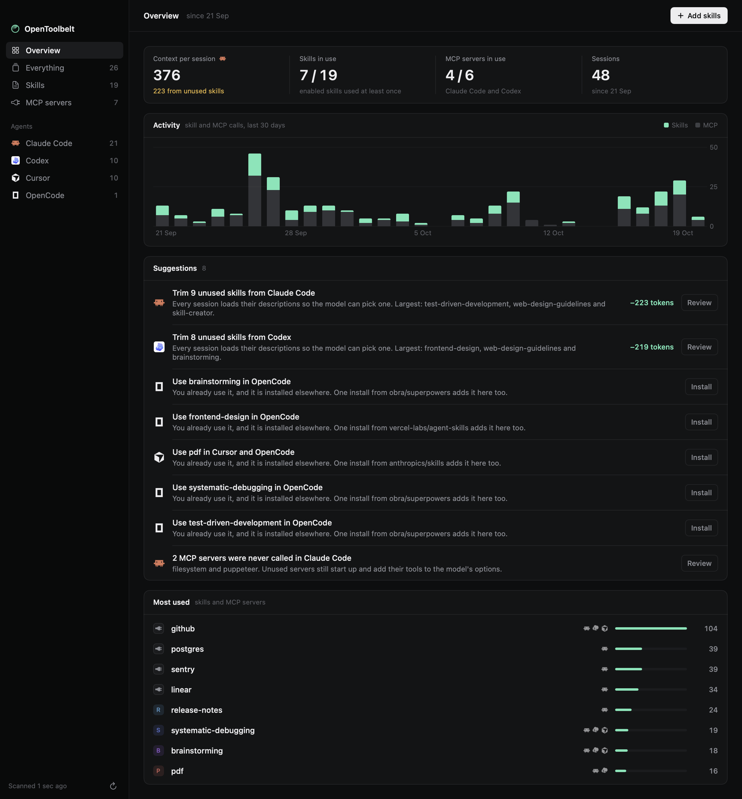
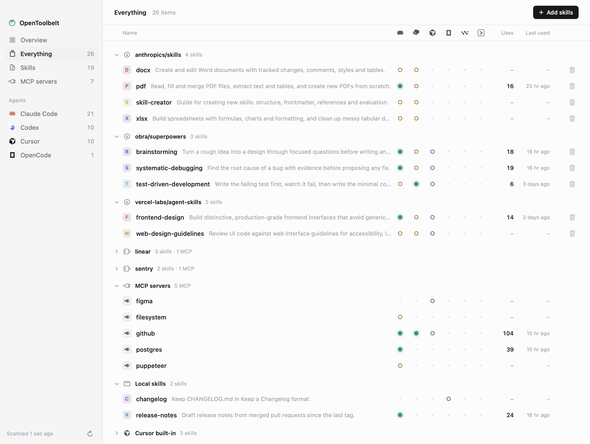

<p align="center">
  
</p>

<h1 align="center">OpenToolbelt</h1>

<p align="center">
  See every skill and MCP server your coding agents carry, which ones they actually use, and what the rest costs you.
</p>

<p align="center">
  <a href="https://github.com/apurv-1/OpenToolbelt/releases/latest"><b>Download for macOS</b></a>
  ·
  <a href="#build-from-source">Build from source</a>
  ·
  <a href="docs/design-system.md">Design system</a>
</p>



## Why

Coding agents collect skills and MCP servers fast.
A plugin brings twenty skills, a popular repo brings thirty more, and nobody knows which of them ever run.
Every installed skill still costs something: agents list each skill's name and description at the start of every session, so the model can pick one.
On one real setup, that was about 8,000 tokens per Claude Code session, and more than 90% of it was skills that had never run.

Your agents already write down everything they do in local session logs.
OpenToolbelt reads those logs and puts the answer next to what is installed.

## What it does

- **Shows the cost.** An estimate of the tokens each agent spends listing skills at the start of every session, and how much of that is skills it never uses.
- **Suggests what to do.** Trim unused skills, install a skill you rely on into your other agents, clean up stale lockfile entries, and review MCP servers that were never called. Each suggestion has one button.
- **Lists everything in one place.** Every skill and MCP server across six agents, grouped by where it came from: `npx skills` repos, Claude Code plugins, agent config files, hand-made skills, and built-ins.
- **Adds and removes skills.** Paste `owner/repo`, pick agents, and it runs `npx skills add` for you.
- **Lives in the menu bar.** A quick look at your agents without opening the window.



It supports Claude Code, Codex, Cursor, OpenCode, Windsurf and Gemini CLI.
Usage comes from Claude Code and Codex session logs today.
For the other agents it shows what is installed, and marks usage as not tracked.

## Install

1. Download `OpenToolbelt.dmg` from the [latest release](https://github.com/apurv-1/OpenToolbelt/releases/latest).
2. Open it and drag OpenToolbelt into Applications.
3. Open OpenToolbelt. The app is not notarized by Apple yet, so macOS blocks the first launch.
   Open **System Settings > Privacy & Security**, scroll down, and click **Open Anyway**.

If you prefer the terminal, this clears the download quarantine flag instead:

```bash
xattr -dr com.apple.quarantine /Applications/OpenToolbelt.app
```

OpenToolbelt appears in the menu bar, not the Dock.
Click its radar icon, then **Open OpenToolbelt** for the full window.

**Requirements:** macOS 15 or later on Apple Silicon.
Adding and removing skills needs Node.js, because it runs `npx skills`.

## Privacy

Everything stays on your Mac.
There is no telemetry and no account.
The app reads agent config files and session logs, and never edits them.
It only changes anything when you add or remove a skill, and then it runs `npx skills`, which fetches the source you asked for.

## What it reads

| Agent | Skills | MCP servers | Usage |
|---|---|---|---|
| Claude Code | `~/.claude/skills`, project `.claude/skills`, plugins, claude.ai synced skills | `~/.claude.json`, project `.mcp.json`, plugins | `~/.claude/projects/**/*.jsonl` |
| Codex | `~/.agents/skills`, `~/.codex/skills` | `~/.codex/config.toml` | `~/.codex/sessions` |
| Cursor | `~/.cursor/skills`, built-in skills | `~/.cursor/mcp.json` | not tracked |
| OpenCode | `~/.config/opencode/skills` | `~/.config/opencode/opencode.json` | not tracked |
| Windsurf | `~/.codeium/windsurf/skills` | `~/.codeium/windsurf/mcp_config.json` | not tracked |
| Gemini CLI | `~/.gemini/skills` | `~/.gemini/settings.json` | not tracked |

External skills and their source repos come from `~/.agents/.skill-lock.json`, which `npx skills` maintains.

## How usage is counted

A skill counts as used when the agent calls the `Skill` tool with its name, or when you type `/skill-name` (Claude Code) or `$skill-name` (Codex) in a prompt.
An MCP server counts as used when the agent calls one of its tools, named `mcp__<server>__<tool>` in the log.
Project-scoped items only count usage from sessions that ran inside that project.

The context cost is an estimate: the length of each skill's name and description, at about four characters per token.
It is good for comparing skills and agents, not an exact count.

## Limitations

- Claude Code deletes old session logs after a retention period, so use counts cover only the logs still on disk.
- Usage for Cursor, OpenCode, Windsurf and Gemini CLI is not tracked yet.
- Removing a Claude Code plugin's skills means disabling the plugin, which the app does not do for you yet.

## Build from source

You need macOS 15 or later and Xcode 16 or later.

```bash
git clone https://github.com/apurv-1/OpenToolbelt.git
```

```bash
cd OpenToolbelt && swift build
```

Run the tests:

```bash
swift test
```

Print the report in the terminal, without the app:

```bash
swift run -c release opentoolbelt
```

Build `dist/OpenToolbelt.app` and a DMG:

```bash
scripts/build-app.sh --dmg
```

## Contributing

Issues and pull requests are welcome.
The code is split into three targets:

| Path | What it is |
|---|---|
| `Sources/OpenToolbeltCore` | Reads config files and session logs and builds the report. No UI. |
| `Sources/opentoolbelt` | The command-line report. |
| `Sources/OpenToolbeltApp` | The SwiftUI menu bar app and window. |

The UI follows [docs/design-system.md](docs/design-system.md).
To review UI changes without your own data in the shot, render the views offscreen from a demo setup:

```bash
python3 scripts/demo-home.py /tmp/demo-home
```

```bash
swift run OpenToolbeltApp --snapshot /tmp/shots --home /tmp/demo-home
```

## License

[MIT](LICENSE).
Agent logos come from [lobe-icons](https://github.com/lobehub/lobe-icons) (MIT) and belong to their owners.
